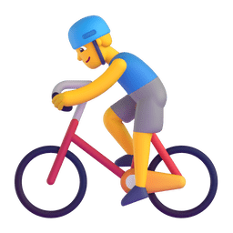
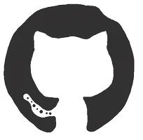
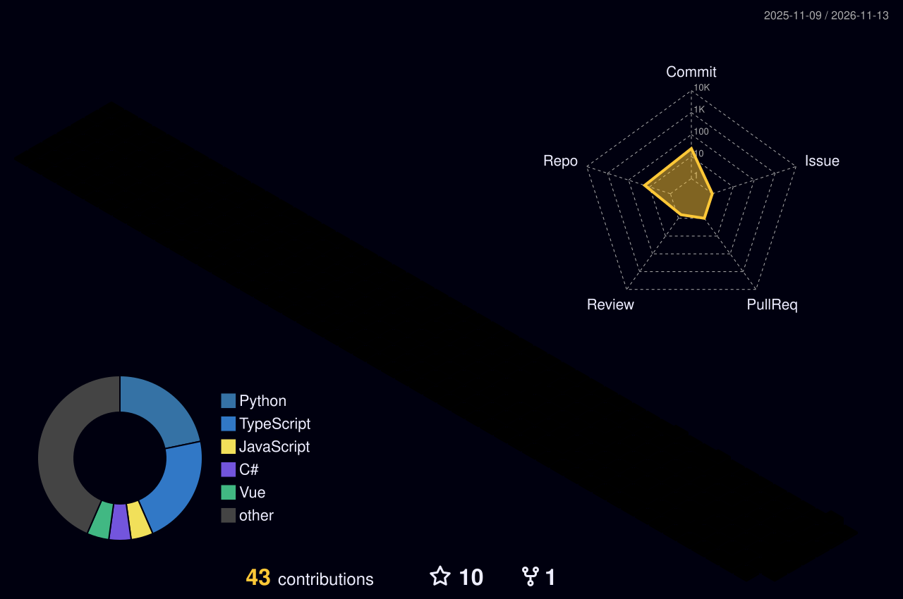

<picture>
  <source media="(prefers-color-scheme: dark)" srcset="./assets/images/coding.gif" />
  <source media="(prefers-color-scheme: light)" srcset="./assets/images/developer.svg" height="225px" />
  
</picture>

&nbsp;

  &emsp;
  &emsp;
  &emsp;
  

<picture>
  <source media="(prefers-color-scheme: dark)" srcset="https://raw.githubusercontent.com/momoqiqi-qwq/momoqiqi-qwq/output/snake-dark.svg" />
  <source media="(prefers-color-scheme: light)" srcset="https://raw.githubusercontent.com/momoqiqi-qwq/momoqiqi-qwq/output/snake.svg" />
  
</picture>

#  🙋 Hello

<table>

<tr><td>

### 🤺 About Me

&emsp;&emsp;嗨，我是 <strong>YG</strong>。写桌面软件，也写能装进口袋的版本。

&emsp;&emsp;这个号里 17 个仓库几乎都是自己一行行写出来的：Tauri 2 打底，原生 JS / Vue / Svelte 做界面，Rust 干脏活，Python 补脚本。同一套东西要能在 Windows、Linux、Android 和微信小程序里跑起来。

&emsp;&emsp;动手前先问一句：这东西能不能不出网？本地优先不是标语，是别让用户的时间、剪贴板、草料棚数据离开他自己的机器。

&emsp;&emsp;<strong>Small tools, heavy polish. Local-first, not cloud-first.</strong>

</tr></td>

<tr><td>

### 📃 最近在做

- Nov 13 - [这个主页：换成 sun0225SUN 那套骨架，数字全换自己的](https://github.com/momoqiqi-qwq/momoqiqi-qwq)
- Nov 12 - [U-Time：把「你的时间」放进「大学的时间」里，四象限决策台 + 时间块规划轴](https://github.com/momoqiqi-qwq/U-Time)
- Nov 11 - [penji：小农户农产品溯源小程序，田间读数自动入库，扫码看这批菜怎么种出来的](https://github.com/momoqiqi-qwq/penji)
- Nov 04 - [WinShortcutLauncher：边缘自动隐藏 + 拖拽排序 + 托盘管理的 Windows 启动器](https://github.com/momoqiqi-qwq/WinShortcutLauncher)
- Nov 03 - [autoaigc：离线判 AI 率再定向改写，原文不出机器](https://github.com/momoqiqi-qwq/autoaigc)
- Oct 27 - [tiez-clipboard：全类型捕获、全文搜索、局域网同步的剪贴板管理器](https://github.com/momoqiqi-qwq/tiez-clipboard)

</td></tr>

<tr><td>

### 📊 提交节律

<picture>
  <source media="(prefers-color-scheme: dark)" srcset="https://github-profile-summary-cards.vercel.app/api/cards/productive-time?username=momoqiqi-qwq&amp;theme=github_dark&amp;utcOffset=8" />
  <source media="(prefers-color-scheme: light)" srcset="https://github-profile-summary-cards.vercel.app/api/cards/productive-time?username=momoqiqi-qwq&amp;theme=default&amp;utcOffset=8" />
  
</picture>
<picture>
  <source media="(prefers-color-scheme: dark)" srcset="https://github-profile-summary-cards.vercel.app/api/cards/repos-per-language?username=momoqiqi-qwq&amp;theme=github_dark" />
  <source media="(prefers-color-scheme: light)" srcset="https://github-profile-summary-cards.vercel.app/api/cards/repos-per-language?username=momoqiqi-qwq&amp;theme=default" />
  
</picture>

</td></tr>

</table>

  <picture>
    <source media="(prefers-color-scheme: dark)" srcset="https://readme-jokes.vercel.app/api?hideBorder&amp;bgColor=%23121212" />
    <source media="(prefers-color-scheme: light)" srcset="https://readme-jokes.vercel.app/api?hideBorder&amp;bgColor=%23ffffff" />
    
  </picture>

<picture>
  <source media="(prefers-color-scheme: dark)" srcset="https://streak-stats.demolab.com?user=momoqiqi-qwq&amp;theme=onedark&amp;hide_border=true&amp;date_format=Y.n.j" />
  <source media="(prefers-color-scheme: light)" srcset="https://streak-stats.demolab.com?user=momoqiqi-qwq&amp;theme=default&amp;hide_border=true&amp;date_format=Y.n.j" />
  
</picture>

<picture>
  <source media="(prefers-color-scheme: dark)" srcset="https://github-profile-summary-cards.vercel.app/api/cards/profile-details?username=momoqiqi-qwq&amp;theme=github_dark" />
  <source media="(prefers-color-scheme: light)" srcset="https://github-profile-summary-cards.vercel.app/api/cards/profile-details?username=momoqiqi-qwq&amp;theme=default" />
  
</picture>

 

<table>
  <tr>
    <td>
      <picture>
        <source media="(prefers-color-scheme: dark)" srcset="https://github-profile-summary-cards.vercel.app/api/cards/stats?username=momoqiqi-qwq&amp;theme=github_dark" />
        <source media="(prefers-color-scheme: light)" srcset="https://github-profile-summary-cards.vercel.app/api/cards/stats?username=momoqiqi-qwq&amp;theme=default" />
        
      </picture>
    </td>
    <td>
      <picture>
        <source media="(prefers-color-scheme: dark)" srcset="https://github-profile-summary-cards.vercel.app/api/cards/most-commit-language?username=momoqiqi-qwq&amp;theme=github_dark" />
        <source media="(prefers-color-scheme: light)" srcset="https://github-profile-summary-cards.vercel.app/api/cards/most-commit-language?username=momoqiqi-qwq&amp;theme=default" />
        
      </picture>
    </td>
  </tr>
</table>

 

 

 

<!-- devicon 图标墙（techstack-generator 已改为付费，换 devicon @ jsdelivr） -->

 

 

<!-- gif -->

<picture>
  <source media="(prefers-color-scheme: dark)" srcset="./profile-3d-contrib/profile-night-rainbow.svg" />
  <source media="(prefers-color-scheme: light)" srcset="./profile-3d-contrib/profile-gitblock.svg" />
  
</picture>

<table>
  <tr>
    <td></td>
  </tr>
  <tr>
    <td>
      <picture>
        <source media="(prefers-color-scheme: dark)" srcset="https://raw.githubusercontent.com/momoqiqi-qwq/momoqiqi-qwq/trophy/trophy-dark.svg" />
        <source media="(prefers-color-scheme: light)" srcset="https://raw.githubusercontent.com/momoqiqi-qwq/momoqiqi-qwq/trophy/trophy.svg" />
        
      </picture>
    </td>
  </tr>
</table>

模板骨架来自 <a href="https://github.com/sun0225SUN/sun0225SUN">sun0225SUN</a>，图片素材一并取自该仓库；数字、文案、语言环全是本号真实数据。

