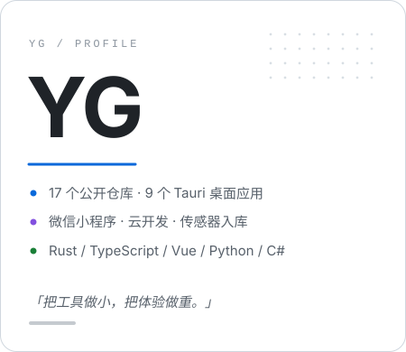

### 👋 Hi there

<!--
  模板：eryajf/eryajf（结构、节奏、视觉层级全按其来）
  还剩两处可以按实际情况微调（都是一行，改起来不影响别处）：
    1. 博客 —— 现在指向 leleblog 仓库（线上域名未定）；部署好了把「欢迎来访」和「最近在做」里那两处链接换成域名
    2. Location 徽章写的是 LangFang，取自 liangyile527 的资料，不在廊坊就改那一处
  其余全部是 momoqiqi-qwq 的真实数据，没有占位符。
-->

<picture>
  <source media="(prefers-color-scheme: dark)" srcset="assets/header-dark.svg">
  
</picture>

有时候觉得自己并不像一个"写代码的人"。明明整天对着终端，可更多时候喜欢从代码里跳出去，回过头看这一群人：我们造工具，工具再反过来改我们的作息，这一来一回，挺有意思。

高中时读《庄子》，读到庖丁解牛那段，记了很多年。庖丁给文惠君宰牛，手触、肩倚、足履、膝踦，刀下去"砉然向然"，合于《桑林》之舞。文惠君惊了，问他技艺怎么会高到这个地步。庖丁放下刀说："**臣之所好者道也，进乎技矣。**"他说自己刚开始宰牛时，满眼都是整头牛；三年之后，眼里再没有完整的牛；到如今，"**臣以神遇而不以目视**"，刀在骨节的空隙里游走，十九年下来，刀刃若新发于硎。

第一次读到只觉得写得漂亮。后来自己动手写东西才明白，那句话讲的是：真正顺手的工具，是不需要被想起的。打开就用，用完就走，你在意的是手头这件事，而不是软件本身。

想说的其实很简单，就三点：

- 1，`把工具做小，把体验做重`。我做的多数东西都很小：一个剪贴板、一个启动器、一块时间表。它们不解决宏大问题，只负责让某一件小事少按两下键盘。用户感受不到"功能"，只感受到顺——这是我理解的合格线。
- 2，`能在自己机器上跑完的，就不绕去云端`。数据是我的，网络会断，服务会停，账单会来。所以桌面端用 `Tauri 2 + Rust`，能本地算的绝不外发；绕不开云的部分（小程序、云开发）就老老实实上云，先把边界想清楚再动手。
- 3，`做东西是为了给具体的人用`。给村里草料棚做的火情预警，给农户做的溯源小程序——它们不会上热榜，但坏了是真的有人遭殃。想到这一点，写代码的手会稳一些。

庖丁那把刀用了十九年，还像刚从磨石上取下来。希望自己做的东西，也经得起这么用。

 

### 🤗 欢迎来访

> 

 
> 

### 🧰 语言工具

<table>
  <tr>
    <td></td>
    <td></td>
    <td></td>
    <td></td>
    <td></td>
    <td></td>
    <td></td>
  </tr>
</table>

  
  
  
  
  
  

### 💻 Stats

点击展开 ...

<picture>
  <source media="(prefers-color-scheme: dark)" srcset="https://github-profile-summary-cards.vercel.app/api/cards/profile-details?username=momoqiqi-qwq&amp;theme=github_dark">
  
</picture>

<picture>
  <source media="(prefers-color-scheme: dark)" srcset="https://github-profile-summary-cards.vercel.app/api/cards/stats?username=momoqiqi-qwq&amp;theme=github_dark">
  
</picture>
<picture>
  <source media="(prefers-color-scheme: dark)" srcset="https://github-profile-summary-cards.vercel.app/api/cards/most-commit-language?username=momoqiqi-qwq&amp;theme=github_dark">
  
</picture>

<picture>
  <source media="(prefers-color-scheme: dark)" srcset="https://streak-stats.demolab.com?user=momoqiqi-qwq&amp;theme=tokyonight&amp;hide_border=true&amp;date_format=Y.n.j">
  
</picture>

<picture>
  <source media="(prefers-color-scheme: dark)" srcset="https://raw.githubusercontent.com/momoqiqi-qwq/momoqiqi-qwq/output/snake-dark.svg">
  
</picture>

### 🏊 更多仓库

点击展开 ...

|                                      Project                                       |                                                   Stars                                                    |                                                   Forks                                                    |              Remark              |
| :--------------------------------------------------------------------------------: | :--------------------------------------------------------------------------------------------------------: | :--------------------------------------------------------------------------------------------------------: | :------------------------------: |
|                [U-Time](https://github.com/momoqiqi-qwq/U-Time)                |                                |                                | 四象限 × 时间块的时间管理平台，插件化，Win / Linux / Android / 小程序 |
|              [penji](https://github.com/momoqiqi-qwq/penji)              |                            |                            | 小农户农产品溯源：传感器读数入库 → 批次档案 → 扫码核验 |
|     [WinShortcutLauncher](https://github.com/momoqiqi-qwq/WinShortcutLauncher)     |          |          | Windows 桌面启动器：贴边隐藏、拖拽排序、多主题 |
|            [easy-espanso](https://github.com/momoqiqi-qwq/easy-espanso)            |                        |                        | Espanso 可视化配置器：片段 / 命令 / 脚本 / 应用专属规则 |
|          [tiez-clipboard](https://github.com/momoqiqi-qwq/tiez-clipboard)          |                    |                    | 全类型剪贴板：标签筛选、全文搜索、局域网传输 |
|          [qq-mail-unread](https://github.com/momoqiqi-qwq/qq-mail-unread)          |                    |                    | QQ 邮箱多账号未读提醒，本地后端 + Chrome 扩展 |
| [tauri-source-extractor](https://github.com/momoqiqi-qwq/tauri-source-extractor) |  |  | 一键导出可喂给 AI 的 Tauri 源码包 / zip |
| [multichannel-extractor](https://github.com/momoqiqi-qwq/multichannel-extractor) |  |  | 多通道批量解压与任务中心桌面应用 |
|               [yasb-gui](https://github.com/momoqiqi-qwq/yasb-gui)               |                              |                              | YASB 配置器中文增强版，Windows · WinUI 3 |
|        [anpeng-desktop](https://github.com/momoqiqi-qwq/anpeng-desktop)        |                |                | 农村草料棚火情预警与初期喷淋，桌面端 |
|             [autoaigc](https://github.com/momoqiqi-qwq/autoaigc)             |                          |                          | 本地优先的 AIGC 率检测与改写闭环 |
|            [leleblog](https://github.com/momoqiqi-qwq/leleblog)            |                        |                        | Astro 5 + Svelte 5 博客，主题与排版深度定制 |

### 📝 最近在做

点击展开 ...

- 🕰️ **U-Time** —— 把「你的时间」放进「大学的时间」里，四象限决策台 + 时间块规划轴 · `2026-11-12`
- 🌱 **penji** —— 田间传感器读数自动入库，农事随手一记就生成批次档案 · `2026-11-11`
- 🧯 **anpeng-desktop** —— 草料棚火情预警的桌面端，WinUI 3 那一版 · `2026-11-12`
- 📦 **tauri-source-extractor** —— 扫一遍 Tauri 工程，把能喂给 AI 的源码打包吐出来 · `2026-11-12`
- 📋 **tiez-clipboard** —— 全类型剪贴板，标签 + 全文搜索 + 一台机器传到另一台 · `2026-10-27`
- ⌨️ **easy-espanso** —— 让 Espanso 的配置不用再手写 YAML · `2026-11-04`

更多碎碎念与长文：[leleblog](https://github.com/momoqiqi-qwq/leleblog)

### 🥇 Badges

<picture>
  <source media="(prefers-color-scheme: dark)" srcset="https://raw.githubusercontent.com/momoqiqi-qwq/momoqiqi-qwq/trophy/trophy-dark.svg">
  
</picture>

  
  
  
  

把工具做小，把体验做重。

