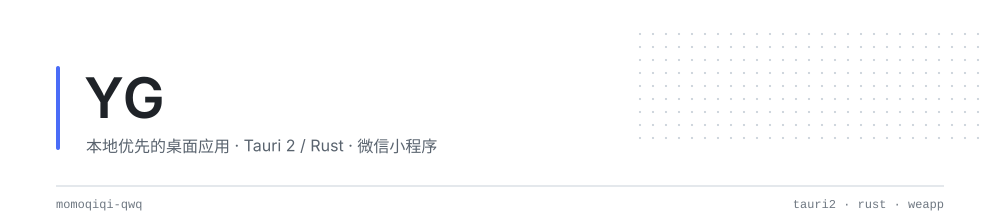

<picture>
  <source media="(prefers-color-scheme: dark)" srcset="assets/header-dark.svg">
  
</picture>

### 关于

写本地优先的工具：能在自己机器上跑完的，就不绕去云端。
桌面端 **Tauri 2 + Rust**，小程序端 **微信云开发**，AI 侧做本地推理与 agent 工具链。

### 在做的

| 项目 | 一句话 | 栈 |
| :--- | :--- | :--- |
| [**U-Time**](https://github.com/momoqiqi-qwq/U-Time) · [在线](https://momoqiqi-qwq.github.io/U-Time/) | 时间块 × 四象限的本地优先时间管理平台，插件化，Win / Linux / Android / 小程序 | `Tauri 2` `Rust` `原生 JS` |
| [**penji**](https://github.com/momoqiqi-qwq/penji) · [在线](https://momoqiqi-qwq.github.io/penji/) | 小农户农产品溯源：田间传感器读数自动入库 → 批次档案 → 扫码核验 | `小程序` `云开发` `MQTT` |
| [**easy-espanso**](https://github.com/momoqiqi-qwq/easy-espanso) | Espanso 可视化配置器：文本片段、命令、脚本、网页与应用专属规则 | `Tauri 2` `Vue 3` `Rust` |
| [**WinShortcutLauncher**](https://github.com/momoqiqi-qwq/WinShortcutLauncher) | Windows 桌面启动器：贴边自动隐藏、拖拽排序、系统图标提取、多主题 | `Tauri 2` `React` `Win32` |
| [**tiez-clipboard**](https://github.com/momoqiqi-qwq/tiez-clipboard) | 全类型剪贴板管理器：标签筛选、全文搜索、局域网传输、多端同步 | `Tauri 2` `React` `Rust` |
| [**qq-mail-unread**](https://github.com/momoqiqi-qwq/qq-mail-unread) | QQ 邮箱多账号未读提醒，本地后端 + Chrome 扩展 | `JS` `Chrome MV3` |

### 数据

<picture>
  <source media="(prefers-color-scheme: dark)" srcset="https://github-profile-summary-cards.vercel.app/api/cards/profile-details?username=momoqiqi-qwq&amp;theme=github_dark">
  
</picture>

<picture>
  <source media="(prefers-color-scheme: dark)" srcset="https://github-profile-summary-cards.vercel.app/api/cards/stats?username=momoqiqi-qwq&amp;theme=github_dark">
  
</picture>
<picture>
  <source media="(prefers-color-scheme: dark)" srcset="https://github-profile-summary-cards.vercel.app/api/cards/most-commit-language?username=momoqiqi-qwq&amp;theme=github_dark">
  
</picture>

<picture>
  <source media="(prefers-color-scheme: dark)" srcset="https://streak-stats.demolab.com?user=momoqiqi-qwq&amp;theme=tokyonight&amp;hide_border=true&amp;date_format=Y.n.j">
  
</picture>

<picture>
  <source media="(prefers-color-scheme: dark)" srcset="https://raw.githubusercontent.com/momoqiqi-qwq/momoqiqi-qwq/output/snake-dark.svg">
  
</picture>

### 常用

  
  
  
  
  
  
  
  

奖杯墙

<picture>
  <source media="(prefers-color-scheme: dark)" srcset="https://raw.githubusercontent.com/momoqiqi-qwq/momoqiqi-qwq/trophy/trophy-dark.svg">
  
</picture>

把工具做小，把体验做重。

